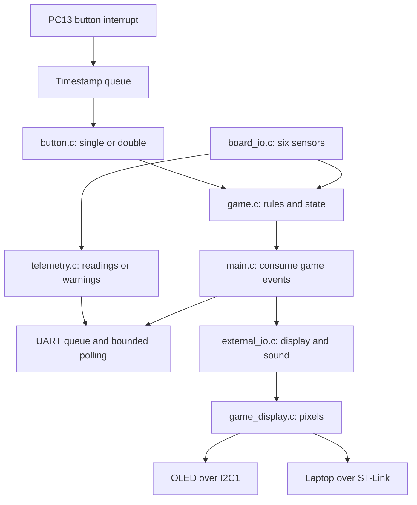
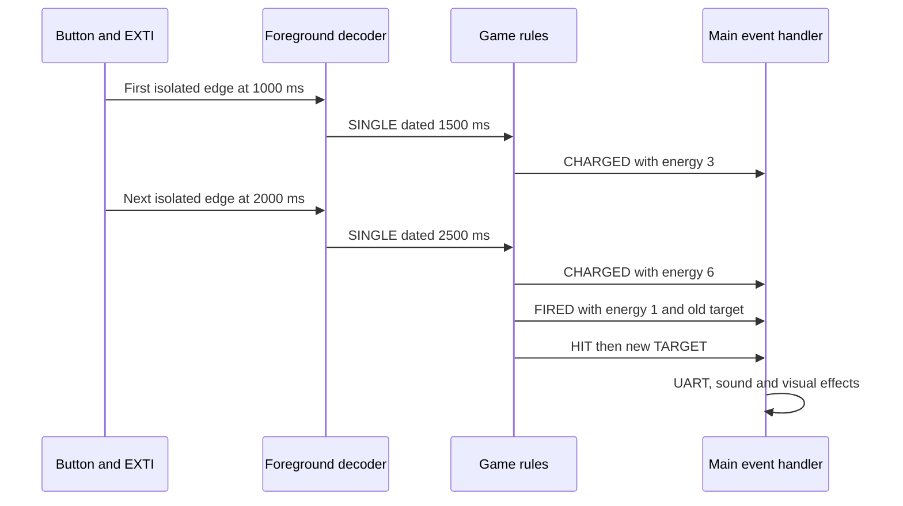
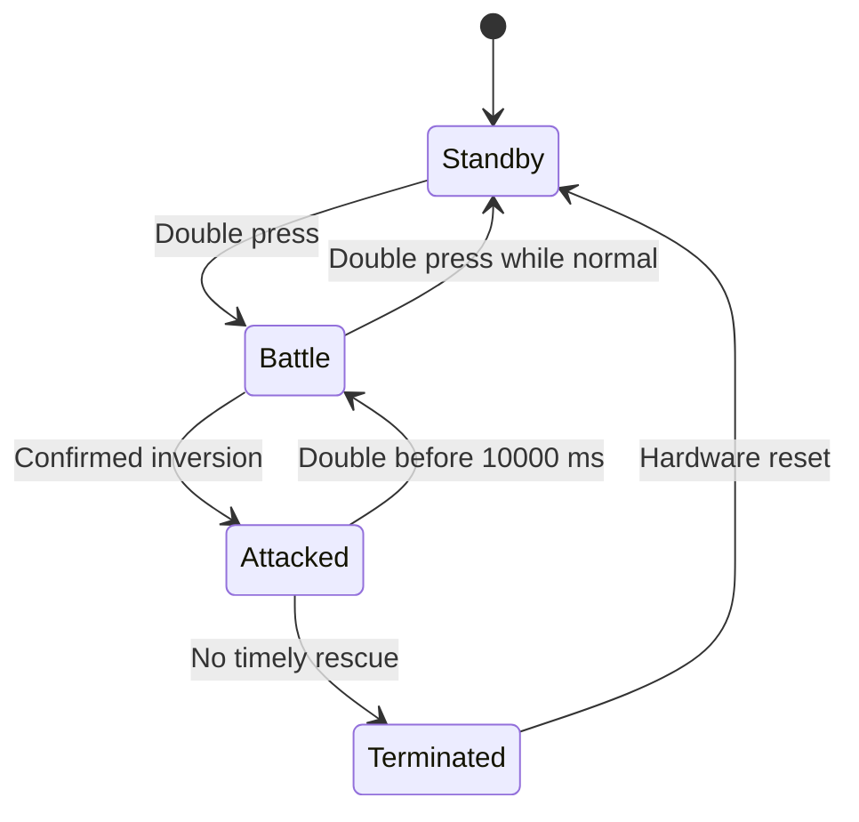

# Garden Guard code guidebook

This guide explains the current STM32L4S5 firmware and laptop viewer, as of
24 October 2026. Keep the project open beside you. The aim is to help
you follow a button press from an electrical signal to a game decision, a UART
message, a sound and a picture. Focus on each component's responsibility
before memorizing driver details.

The compulsory assignment is a drone controller: standby, battle, charging,
sensor telemetry, attack detection, rescue and termination. Garden Guard adds
targets, score, lives, animation, reflective IR assistance and sounds. Those
additions sit around the compulsory controller. Winning or losing a garden
round does not terminate the drone.

Start with [main.c](../Core/Src/main.c), then follow links as a question arises.
The [requirements matrix](requirements.md) maps the original brief to code and
evidence. The [demo checklist](demo-checklist.md) describes remaining bench
checks. Physical test completion is recorded separately.

## 1. The system in one picture



There is one foreground loop. Interrupts briefly interrupt that loop to record
button edges, advance the millisecond clock or toggle the
buzzer. There is no operating system scheduling separate game tasks.

The distinction between rules and hardware is deliberate. `game.c` receives
ordinary C values and timestamps. It does not know which GPIO pin is a button
or how I2C works. `board_io.c` handles those physical details. `main.c` connects
them. This makes the rules testable on a laptop while the hardware code stays
specific to the STM32 board.

## 2. A map of the project

For each application module, the `.h` file describes its public types and
functions; the `.c` file implements them. An `#include` lets the compiler see
those declarations. It does not paste another compiled program into the board.

| Application files | Responsibility |
| --- | --- |
| [main.c](../Core/Src/main.c), [main.h](../Core/Inc/main.h) | Connect modules, schedule work and consume events; `main.h` also names board pins. |
| [button.c](../Core/Src/button.c), [button.h](../Core/Inc/button.h) | Debounce accepted edges and distinguish single from double presses. |
| [game.c](../Core/Src/game.c), [game.h](../Core/Inc/game.h) | Modes, energy, targets, scoring, attack detection, rescue and game events. |
| [board_io.c](../Core/Src/board_io.c), [board_io.h](../Core/Inc/board_io.h) | Clock, sensors, LED and queued UART with bounded polling. |
| [telemetry.c](../Core/Src/telemetry.c), [telemetry.h](../Core/Inc/telemetry.h) | Check limits and format either normal readings or warnings. |
| [external_io.c](../Core/Src/external_io.c), [external_io.h](../Core/Inc/external_io.h) | OLED transport, laptop framebuffer, IR, buzzer and optional colour sensor. |
| [game_display.c](../Core/Src/game_display.c), [game_display.h](../Core/Inc/game_display.h) | Draw the original game artwork into a 1,024-byte image. |
| [sensor_sample.h](../Core/Inc/sensor_sample.h) | Common sensor values, physical units and validity bits. |
| [app_config.h](../Core/Inc/app_config.h) | Module switches, pin defaults, timing and telemetry thresholds. |
| [game_config.h](../Core/Inc/game_config.h) | Energy, scoring and motion-detection constants. |

Several support files are essential but rarely need changes. `stm32l4xx_it.c`
and its header contain interrupt handlers, including SysTick and EXTI.
`stm32l4xx_hal_msp.c` supplies low-level HAL support. `stm32l4xx_hal_conf.h`
selects HAL components. `system_stm32l4xx.c` provides early system setup.
`syscalls.c` and `sysmem.c` support the C library, including heap allocation.
They are not the telemetry output mechanism.

`Drivers/STM32L4xx_HAL_Driver` is ST's Hardware Abstraction Layer: functions for
GPIO, timers, UART and I2C. `Drivers/BSP` is the Board Support Package and
individual sensor drivers. CMSIS supplies processor and register definitions.
The application uses the BSP for initialization but performs checked, bounded
sensor reads rather than blindly trusting convenience getters.

The assembly startup file sets the stack, calls `SystemInit`, copies initialized
data from flash into RAM, clears zero-initialized data and calls `main`.
`STM32L4S5VITX_FLASH.ld` is the linker script: it places code, constants, data,
stack and heap into the board's memory map. The root `Makefile` builds this
application. The inherited `Debug/makefile` describes the starter project.

The Python and shell tools run on the computer:

| Tools | Purpose |
| --- | --- |
| `arm-tool.sh`, `build_config.py` | Find Arm tools and detect changed build flags. |
| `board.py`, `openocd.cfg`, `debug.gdb` | Detect, flash or debug the selected board. Debug commands halt/reset. |
| `monitor.py`, `capture_uart.py` | Read UART; the latter uses POSIX facilities without pyserial. |
| `hardware_smoke.py`, `reset_capture.py` | Record a flash/boot check or a reset-only capture. |
| `inspect_live.py` | Read sensor and game memory without an intentional halt or reset. |
| `live_display.command`, `live_display.py` | Launch and draw the native laptop window. |
| `live_display_transport.py` | Verify firmware and read coherent live images through ST-Link. |
| `preview_display.py` | Compile the real C renderer for offline sample scenes. |
| `make_slides.py`, `package.py` | Generate draft slides and a separate source archive; neither submits coursework. |

## 3. C concepts you will meet

A `struct` groups related values. `Game` contains energy, mode, lives and timing
information. A `SensorSample` contains readings and a validity mask. An `enum`
gives meaningful names to alternatives, such as `GAME_STANDBY` and
`GAME_BATTLE`. These names make a decision clearer than unexplained numbers.

Pointers let a function operate on an existing object:

```c
Game game;
game_init(&game, now);
```

`&game` means "the address of game". The function parameter `Game *game` holds
that address. Inside it, `game->energy` accesses the energy field of the
pointed-to object. Passing this pointer avoids copying the entire structure.
A `const SensorSample *sample` promises that this function will not modify
the sample through that pointer.

At file scope, `static` keeps a name private to that source file. A static
object also lives for the program's whole execution; it is not a temporary
local variable recreated on every loop. Small helper functions are static so
other modules cannot accidentally call internal implementation details.

`volatile` tells the compiler that a value can change outside ordinary visible
control flow. The button queue indexes are shared with interrupt handlers.
The laptop sequence is observed through the debugger.
Volatile does not make a multi-step update atomic, protect an entire array or
replace synchronization. Short interrupt-masked sections and memory barriers
handle those separate requirements.

A bitmask stores several yes/no answers in one integer. Sensor bits occupy
positions zero through five:

```c
bool temperature_valid = (sample.valid & SENSOR_TEMPERATURE) != 0u;
bool all_valid = (sample.valid & SENSOR_ALL) == SENSOR_ALL;
```

`0x3f` means all six bits are set. Initialization success and current validity
are different: a sensor that initialized can still fail its next transaction.
This is why the code checks validity again when it uses a reading.

## 4. What happens after reset

After the startup assembly reaches `main`, `HAL_Init()` prepares HAL and its
default millisecond tick. `Board_Init()` configures power and clocks. The
internal 4 MHz MSI oscillator feeds a PLL: `4 MHz / 1 * 40 / 2 = 80 MHz`.
Clock configuration updates the HAL time base for the new clock frequency.
`SysTick_Handler` calls `HAL_IncTick()` every millisecond; `HAL_GetTick()` reads
that accumulated count. SysTick's configured interrupt priority is zero;
on this Cortex-M processor, a smaller priority number means higher urgency.

Board setup then initializes the status LED, interrupt button, USART1 and
sensor bus. Sensor identities and selected control registers are checked.
Temperature and humidity calibration constants are read from the HTS221.
Missing sensors are recorded individually rather than treated as valid zeros.
`External_Init()` independently configures the optional modules.

Next the input decoder and game are initialized. `game_init()` creates a
standby event with zero energy, three lives and a reproducible random seed.
`main.c` consumes that event and queues the standby message. A boot sensor
read can establish the upright gravity reference. Keep the board still in its
intended upright orientation during this stage.

The infinite loop begins. A clock or UART startup failure instead enters
`Error_Handler`; it does not advertise a successfully running game.

## 5. Doing many jobs without waiting

The loop repeatedly asks whether work is due. It does not wait one second
inside a delay function. The `due()` helper compares the current tick with the
previous scheduled time and advances that schedule when necessary.

| Work | Nominal interval | Reason |
| --- | --- | --- |
| Read all six sensor quantities and report telemetry | 1,000 ms | Compulsory monitoring cadence. |
| Refresh accelerometer and gyroscope | 50 ms | Follow a flip between full sensor sweeps. |
| Generate a display frame | 33 ms | Approximately 30 frames per second for the laptop. |
| Service inputs, events, UART and external modules | Every loop | React promptly and make incremental progress. |

There is still finite execution time. A bounded I2C transaction can occupy the
foreground for several milliseconds. Interrupts can record presses during
that work. The loop drains timestamped input before advancing other states,
and again after sensor reads. This ordering helps an edge captured before a
deadline keep its proper meaning when processed slightly later.

"Nonblocking" here means no long application wait for a complete operation.
UART messages are queued and transmitted in short foreground chunks, OLED
frames are sent incrementally, and sound notes advance by timestamps. HAL
UART and I2C calls still block until completion or a short timeout. Their
bounded cost is different from sleeping through a whole button window or
rescue countdown.

## 6. From a button edge to a command

PC13 generates an EXTI interrupt. Its callback records `HAL_GetTick()` into a
32-entry circular queue and returns. It does not debounce, print, draw or read
sensors. One slot distinguishes full from empty, so 31 edges can be queued.
An overflow discards input and resets the decoder rather than interpreting a
damaged sequence as a command.

In the foreground, `button_press()` rejects edges less than 30 ms after the
last accepted press. An accepted first edge becomes pending. Nothing charges
yet because a second edge may turn it into a double press.

An accepted second edge less than 500 ms after the first returns
`BUTTON_DOUBLE` immediately. Otherwise `button_poll()` resolves the first
press as `BUTTON_SINGLE` once its 500 ms window has elapsed. Exactly 500 ms
is outside the double window. The older single resolves and the new press
can start its own window.

The event timestamp is the second edge for a double, or first edge plus
500 ms for a single. It is not simply the later processing time. Briefly
masking interrupts around the empty-queue check and single poll prevents an
edge at 499 ms from losing a race to the timeout.

## 7. Trace two charging presses yourself

Assume battle is active, a zombie is present, energy is zero and no attack
occurs. Press once at 1,000 ms. The interrupt queues that time; the decoder
waits. At approximately 1,500 ms it resolves a single. `game_button()` adds
three energy units and emits `GAME_EVENT_CHARGED` with energy three.
There is not enough energy to fire.

Press once at 2,000 ms. At approximately 2,500 ms the next single raises
energy from three to six. The rules emit a charged event, subtract five, then
emit a fired event with one energy remaining. A zombie hit increases score
by ten, optionally adds the five-point IR bonus, and increments zombie hits.
Unless the round finishes, a new target starts immediately.



`main.c` consumes these events in order. UART reports charging to six, firing
with one remaining, the hit and the new target. Sound and visual effects
follow those events. The shot sound can replace the lower-priority charge
sound because both arose in the same iteration.

Each `GameEvent` stores its own target, energy, score and timestamp. The hit
event therefore still refers to the zombie even after `game.target` changes
to a human. `display_event()` also preserves the old target's approach age
before processing the new-target event. The renderer can show the old zombie
being hit while the next human starts approaching. Without those snapshots,
the animation could incorrectly fire at the newly selected target.

## 8. Three kinds of state, with different jobs



The diagram's `Attacked` box is represented by `game.attacked` while
`game.mode` remains `GAME_BATTLE`. The primary mode is standby, battle or
terminated. Separately, `game.round` is active, won or lost. A won or lost
round still permits compulsory battle charging, monitoring and rescue.
Returning to standby and entering battle again starts a fresh round.

Battle entry resets score, lives to three and zombie hits to zero. Energy
persists across ordinary mode changes. From empty, consecutive resolved
singles leave energy at `3, 1, 4, 2, 0, ...` because each single adds three
and enough energy automatically triggers a five-unit shot.

A zombie hit gives ten points; IR lock adds five. A human avoided for its
full four-second period gives five points. Shooting a human or allowing a
zombie to escape costs five points and one life. Six zombie hits wins; zero
lives loses. Targets use a deterministic pseudo-random sequence, so a fresh
reset repeats the initial sequence. Starting another round does not reseed it.

The LED is computed from elapsed time. Standby is continuously on. Normal
battle alternates every 500 ms, making one complete cycle per second.
Attacked battle alternates every 250 ms, making two cycles per second.
Terminated is off.

## 9. Sensor numbers need units and freshness

The six compulsory quantities come from four chips: HTS221 temperature and
humidity, LPS22HB pressure, LSM6DSL acceleration and angular velocity, and
LIS3MDL magnetic field. They share on-board I2C2 on PB10/PB11. External OLED
I2C1 uses PB8/PB9 and is a separate bus.

| Quantity | Representation in `SensorSample` |
| --- | --- |
| Temperature | Degrees Celsius, using factory calibration. |
| Pressure | hPa; raw pressure divided by 4,096. |
| Humidity | Percent relative humidity, using factory calibration. |
| Acceleration | Three axes in m/s^2; sensitivity and gravity-unit conversion applied. |
| Angular velocity | Three axes in degrees/second; millidegrees converted to degrees. |
| Magnetic field | Three axes in microtesla; milligauss converted to microtesla. |

The code checks identities, configuration, data-ready status and transaction
success. Invalid values are cleared and represented as unavailable, including
NaN where appropriate. Motion reads preserve other sensor fields. A full
sweep refreshes all fields. A very recent motion conversion may be reused
within one 50 ms motion interval when a full sweep immediately follows a
motion read; indefinitely stale data is not accepted as fresh.

`Telemetry_Check()` compares physical values against the limits in
`app_config.h`. Acceleration, gyro and magnetic thresholds use vector
magnitude, `sqrt(x*x + y*y + z*z)`. Normal UART output includes all axes with
units. If any quantity is abnormal or unavailable, `Telemetry_Format()` emits
the relevant warning lines and suppresses the normal complete reading.
Normal reporting resumes when all quantities recover.

The 200 microtesla magnetic limit is an empirical starting point. Readings
around 233 microtesla in a recorded session explain repeated magnetic warnings;
they do not establish calibration or the cause of that field. Thresholds need
a measured baseline and a physical explanation. Pressure is reported directly;
this code does not calculate calibrated altitude from it.

## 10. Detecting attack and timing rescue

A gyroscope measures angular velocity, not absolute upside-down orientation.
The implementation combines gyro rotation with acceleration's gravity
direction. The first valid sample with acceleration magnitude from 6 to
13 m/s^2 and gyro magnitude at most 20 degrees/second establishes an upright
reference. This is one accepted sample, not a timed averaging procedure.
Later samples are compared with that reference using a dot product:
opposite directions give a negative result.

The code requires valid acceleration and gyro readings, plausible gravity
magnitude, at least 60 degrees of accumulated gyro rotation and sustained
inversion for 350 ms. Gaps longer than 250 ms invalidate the continuity
assumption. These checks reduce reactions to brief noise or missing samples;
they need a real, smooth flip test to establish physical performance.
The 250 degrees/second telemetry warning limit is a separate concern: the
attack detector accepts gyro magnitude up to 2,000 degrees/second. A warning
does not itself mean an attack has been detected.

When attack is confirmed, the rules record `attacked_since_ms`, disarm another
attack and emit an attacked event. UART reports the attack immediately and
then every second. The LED changes to 2 Hz. Singles are ignored. A double
whose second accepted edge occurs before 10,000 ms rescues the drone; exactly
10,000 ms is too late. Rescue preserves score, lives, energy and the current
target, while restarting that target's four-second period. After rescue,
return upright to rearm detection.

Unsigned elapsed-time arithmetic supports tick wrap:

```c
uint32_t elapsed = now - started;
if (elapsed >= APP_RESCUE_MS) {
    /* The rescue deadline has expired. */
}
```

For a short interval crossing the 32-bit counter's wrap, subtraction still
produces the elapsed milliseconds. Historical-event ordering uses signed
differences, assuming the compared boundaries are less than half the counter
range apart. Rollover tests cover these distinctions.

## 11. UART: formatting and transmitting are separate

`snprintf()` and `vsnprintf()` format characters into bounded RAM buffers.
They do not send those characters to the terminal. The firmware does not use
`printf()` retargeting or semihosting for telemetry.

`Board_UartWrite()` copies a complete message into a 4,096-byte circular queue.
`Board_UartPoll()` calls the exact Lab 5 function, `HAL_UART_Transmit()`, on at
most 16 contiguous bytes, with a 2 ms HAL timeout. It advances the queue after
bytes are submitted to the peripheral, then returns to the scheduler. UART is
polling in the foreground; it does not use a TX completion interrupt. Queue
ownership lets a local formatting buffer be reused safely after copying.

Sixteen bytes take about 1.39 ms at 115200 baud. Interrupts and SysTick remain
enabled while the HAL call polls, so button edges can still be timestamped.
A 2 ms timeout is specified in millisecond ticks; tick quantization and the
HAL comparison can make a faulted call take roughly 3 ms. This is bounded
polling, not fully nonblocking UART. A call must never disable the tick while
waiting for a timeout that depends on that same tick.

On timeout, HAL's remaining-byte count prevents replaying an already submitted
prefix. Three consecutive polls with no progress discard that small chunk and
record the loss rather than pinning the queue forever. Idle requires both an
empty queue and the hardware transmission-complete flag, so stopping UART
does not cut off the final byte merely because its buffer was dequeued.

At 115200 baud with 8N1 framing, each transmitted byte consumes ten serial
bits. A full 4,095-byte queue takes about 356 ms on the wire. This explains
why output draining needs time even though queuing a message is quick.

There is no application `HAL_Delay()` schedule. SysTick timestamps control
deadlines; HAL calls still have bounded internal timeout behavior. An unused
BSP delay wrapper exists in the supplied source, but it is not the foreground
timing method. UART input commands are not implemented: the terminal tools
receive messages and the physical button controls play.

## 12. IR, buzzer and OLED transport

The reflective IR module's digital output enters PC5/A0. By default, low means
an object is present. A changed level must remain stable for 30 ms before the
debounced presence changes. That state becomes `game.aim_locked`. It cannot
identify a zombie, human or colour, and it never blocks compulsory firing.
The optional TCS34725 colour driver is a different device and stays disabled.

The working buzzer signal is D6/PB1. For passive operation, TIM2 counts at
1 MHz and interrupts at twice the requested pitch. Each interrupt toggles
PB1; two toggles form one square-wave cycle. A 1,200 Hz note therefore needs
2,400 toggles per second. TIM2 handles those fast edges while SysTick times
note durations and gaps. The charge tune is 70 ms at 1,200 Hz, 30 ms silence,
then 80 ms at 1,600 Hz. Priority prevents a routine charge sound from replacing
an attack or defeat sound. Active-buzzer mode uses on/off patterns instead.

The OLED expects SSD1306-compatible I2C commands, 128 by 64 pixels and address
`0x3c`. One monochrome frame needs `128 * 64 / 8 = 1024` bytes. Rendering
creates the newest drawing buffer. Before transmission, the driver copies a
complete frame into an immutable send buffer. Subsequent drawing cannot
change the half-transmitted image.

Each poll sends at most one addressing command or 16-byte data chunk at
100 kHz. The panel therefore updates more slowly than the 30 fps laptop
target. Superseded drawing frames can be skipped while a send finishes.
BUSY defers work; a failed previously working OLED waits one second, repeats
configuration and restarts full-frame addressing. An absent boot-time OLED is
not continuously reprobed. Reset retries initialization. These choices keep
an optional display failure from replacing the compulsory controller.

## 13. How the laptop sees the actual game

`External_SetDisplay()` generates the laptop framebuffer even when the OLED
is absent. The MCU executes the original C renderer and game rules. Python
reads those pixels through ST-Link, converts the OLED page-bit layout to an
image, and enlarges each pixel. It does not run another copy of the live game
rules or invent target movements. Offline preview is explicitly separate.

The sequence counter protects against a torn image. Odd means rendering is
underway. C11 sequentially consistent fences keep image writes between the
sequence updates on the target. The host accepts an image only if its before
and after sequence readings are equal, nonzero and even. Zero initially means
no published frame. This is a sequence-lock
protocol; it does not halt the MCU while reading.

```text
MCU: odd sequence -> fence -> draw pixels -> fence -> even sequence
PC:  read sequence A -> read image -> read sequence B
Use the image only when A == B, A != 0, and both are even.
```

The terminal flag is published inside that same protected snapshot. This
protocol covers the image and terminal flag, not arbitrary game/sensor memory.
A new sequence certifies a new completed render; its pixels may happen to be
identical to the previous image. Frame-rate counters measure fresh coherent
renders rather than requiring every pixel image to differ.

Alignment permits 256 word reads instead of 1,024 byte reads. The recorded
benchmark averaged 92.75 ms for byte reads versus 8.36 ms for word reads.
The viewer targets 30 fps, accounts for read time when scheduling, and showed
about 29.4 received and 29.5 displayed fps in the recorded window benchmark.
Those measurements describe that run, not a guaranteed rate on every laptop.

The transport checks the local ELF/BIN and compares the board's flash before
using symbol addresses. Its OpenOCD connection deliberately avoids reset and
halt. Tk stays on the main Python thread; a worker owns board reads and sends
frame events to the window. Closing the viewer closes its connection; the
board continues independently. A coherent terminal flag instead makes the
transport close its own OpenOCD connection automatically after the final
frame. The window retains that image and reports that polling has stopped.

## 14. What termination really stops

At rescue timeout, `game_tick()` sets the irreversible terminated mode and
queues final events. `shutdown_system()` turns off the LED and prepares a
final static display. It drains already queued UART bytes and the final OLED
frame, stopping early if both are idle. `APP_SHUTDOWN_DRAIN_MS` gives a 600 ms
budget to allow serialized UART chunks and the OLED frame to finish. The
deadline is checked between UART and OLED work. An already started bounded
peripheral transaction can finish slightly beyond that budget.

The code then stops/deinitializes UART, silences the buzzer, disables button
interrupt processing and SysTick, disables interrupts and waits indefinitely.
No new sensor acquisition or gameplay occurs during that output drain.
Another button press cannot rescue after the deadline; reset is the restart.

External debugger capability is separate. The SRAM image still exists after
termination, but the viewer reads `laptop_display_terminal` within the coherent
final snapshot and closes its owned ST-Link connection. It does not continue
polling or automatically reconnect. The window says "SESSION ENDED"; reset
the board and explicitly reconnect to start viewing a new session. Record
UART silence directly as evidence of application cutoff. A static final
laptop picture is the retained last frame, not fresh game activity.

## 15. Building, testing and changing the right place

Run commands from the project directory:

```sh
make
make host-test
python3 tools/board.py detect
```

Building changes files on the computer. Flashing changes the board:

```sh
python3 tools/board.py flash
sh tools/live_display.command
```

The `.elf` contains executable sections, symbol addresses and debug metadata.
The `.bin` is a flat image of loadable bytes. The `.hex` carries bytes with
addresses in a text format. The `.map` explains which objects and symbols
occupy memory. Rebuild before flashing: `board.py flash` deliberately uses
the existing ELF. A configuration stamp detects changed `EXTRA_DEFINES` so
switching module options triggers rebuilding.

The C host suites test rules/button timing, rendering, telemetry, the actual
foreground scheduler with fake hardware, OLED failure recovery and laptop-only
rendering, plus bounded UART polling. AddressSanitizer and UndefinedBehaviorSanitizer catch classes of
memory and arithmetic errors. Python tests check transport parsing and
failure behavior. Passing them establishes behavior under their inputs; it
does not measure GPIO waveforms, calibrated sensor accuracy or real flip
performance.

Hardware records establish selected observations: sensor readings, manual
battle entry, IR presence/release, audible D6 buzzer and live laptop frames.
Some captured game hits used debugger-injected button interrupts. A complete
manual winning round, physical rescue/timeout sequence and measured LED/button
boundaries still need their own evidence. Read a record's date and firmware
identity before applying it to a newer revision.

Change timing, thresholds and module pins in `app_config.h`; update port, pin
and clock together. Change scoring and motion constants in `game_config.h`.
Change rules in `game.c`, artwork in `game_display.c` and device transport in
`external_io.c` or `board_io.c`. Keep button classification out of the ISR
and scoring out of the renderer. Make one understandable change, build, run
the relevant existing checks, then verify the affected physical behavior.

## 16. Use the assignment and Lab 5 references carefully

Lab 5 pages 3, 6, 12 and 17 support the UART and timing framework: USART1
through ST-Link CN7, 115200 baud, eight data bits, no parity, one stop bit,
no flow control, PB6/PB7 on AF7, `HAL_UART_Transmit()`, an interrupt-driven
pushbutton and SysTick timing without `HAL_Delay()`. PB6/PB7 use alternate
function push-pull with pull-ups in this firmware. Optional receive/echo
exercises in the lab are not implemented UART commands in this game.

The administrative wording differs between the documents:

| Topic | Original Assignment 2 brief | Lab 5 page 18 | Preparation |
| --- | --- | --- | --- |
| Duration | 20-minute presentation and demonstration. | 15-minute presentation. | Rehearse a 20-minute full version and a compressed 15-minute version. |
| Contributions | Appendix declaring each member's actual joint and individual work. | Appendix described as optional. | Keep the contribution appendix, with editable draft placeholders until actual work is declared. |
| Slide formats | PPT, PPTX, PDF and KEY appear in its accepted-format list. | PPT is listed. | Use a consistently listed assignment format; keep code ZIP and slides separate. |

Follow the original assignment for the full preparation; confirm the actual
assessment slot if the teaching team provides a newer instruction. The brief
also mentions HTML in one paragraph but omits it from the later accepted-format
list, so do not assume HTML acceptance. Lab 5's 11 November, 1 PM deadline is
section-specific; the original brief lists different deadlines by lab class.
Use the actual class and group identifiers when finalizing submission.

The slide generator defaults to the 20-minute plan. Its `--duration 15` option
creates the compressed run sheet without removing compulsory topics. Neither
variant establishes that planned demonstrations or member contributions have
already happened. Names, matriculation numbers and completed contributions
remain clearly editable draft fields rather than invented facts.

## 17. A short study route and oral questions

First draw the architecture and state diagrams from memory. Next trace the
worked charging example with `button.c`, `game_button()` and `handle_events()`
open. Then explain one sensor conversion and one threshold warning. Finally
walk through attack, rescue and termination, identifying the timestamps that
make each deadline work. Practice on the board after the code trace makes
sense; record what you actually observe.

**Why wait 500 ms for a single?** Until that window closes, the first press
could belong to a double. Immediate charging would charge during mode changes.

**Why record edges in an interrupt but classify them in the loop?** Interrupts
capture timing promptly; foreground code can do more work without holding up
other interrupts.

**Why does a shot leave one energy after two presses?** Zero becomes three,
then six; automatic firing subtracts five.

**Why use acceleration as well as gyro?** Gyro measures rotation rate. Gravity
direction supplies an orientation reference; gyro corroborates movement.

**Why can the old zombie still appear after a new target starts?** Hit effects
retain event snapshots and the old target's age independently of current state.

**Does 30 fps mean the PC controls the game?** No. The STM32 produces pixels;
the PC reads and displays them. Controls and sensor decisions stay on the MCU.

**Does a passing simulation prove the rescue works physically?** It verifies
the simulated paths. Physical sensor motion, wiring and measured timing need
bench evidence.

Useful vocabulary: **GPIO** is a digital pin; **EXTI** is an external interrupt;
**ISR** is its short handler; **SysTick** is the millisecond time base;
**HAL** abstracts peripherals; **BSP** supports the board; **I2C** is a shared
addressed serial bus; **UART** sends serial bytes; **SWD** is the debug link;
**framebuffer** stores image bits; **debounce** rejects contact chatter;
**queue** preserves pending work; **fence** orders memory operations;
**seqlock** detects a changing snapshot; **flash** retains firmware without
power; **RAM** holds live state; **telemetry** reports measured quantities.
