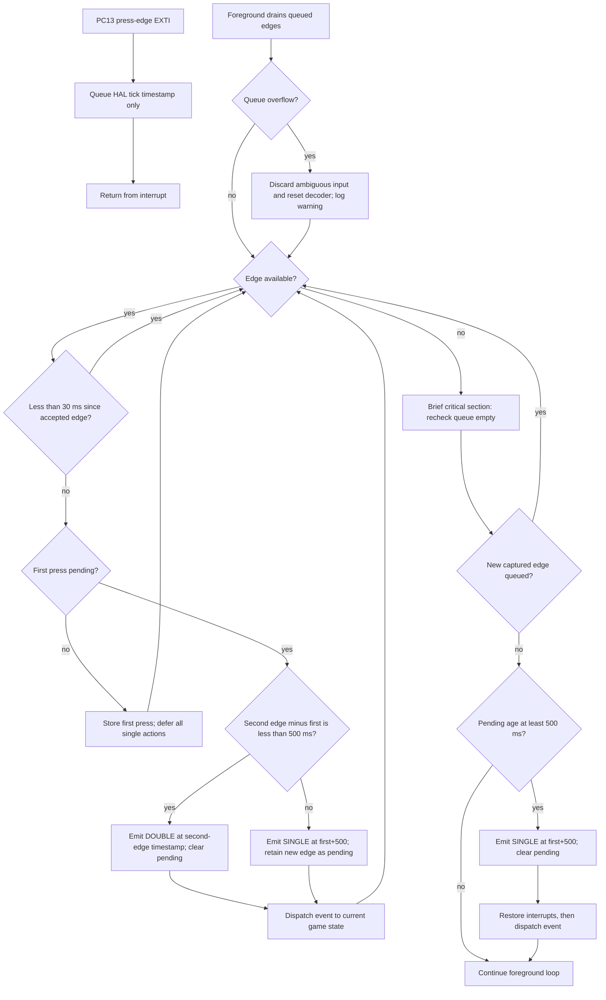
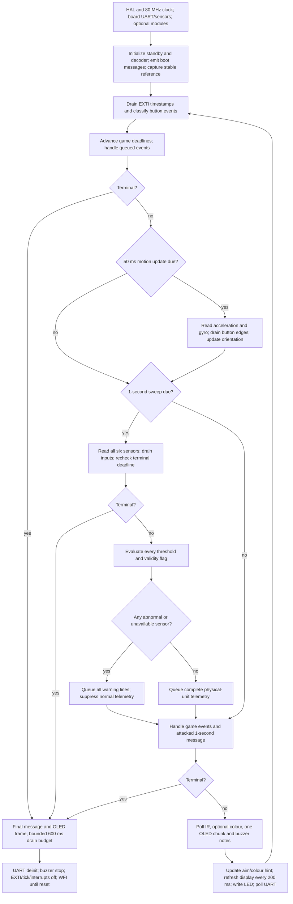
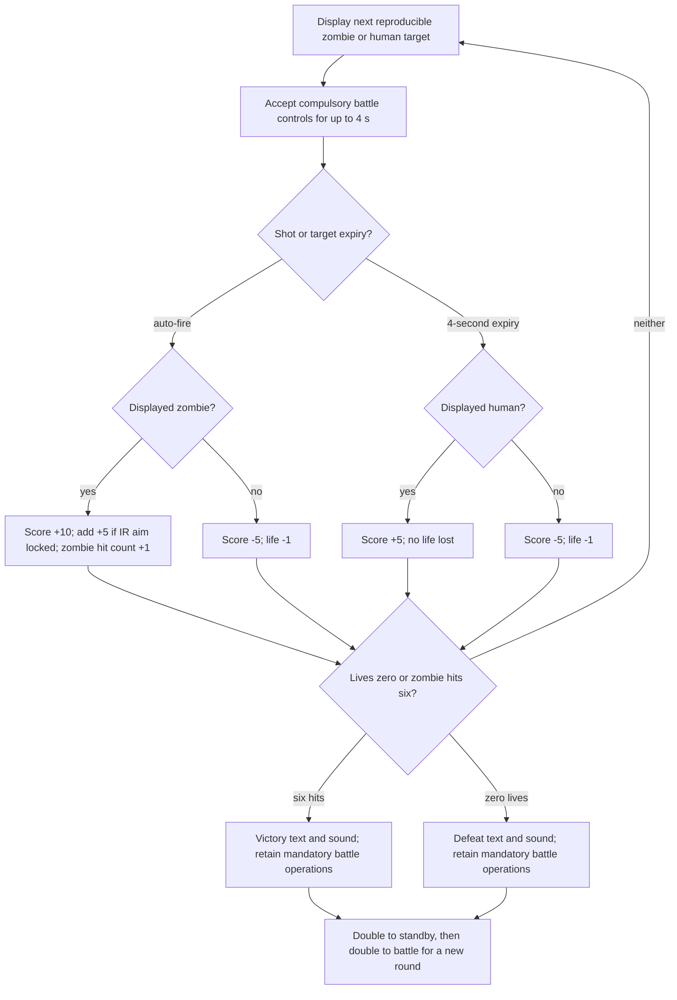

# System flowcharts

These Mermaid diagrams describe the implemented application. Source functions are in `Core/Src/main.c`, `game.c`, `button.c`, `telemetry.c`, `board_io.c` and `external_io.c`. Render the diagrams with a Mermaid-capable Markdown viewer or copy the rendered figures into presentation slides.

## Operating states

```mermaid
stateDiagram-v2
    [*] --> Standby: reset / emit standby entry
    Standby --> Standby: single ignored / LED solid
    Standby --> Battle: double / emit battle entry
    Battle --> Battle: single / charge +3 then auto-fire if energy >=5
    Battle --> Standby: double / LED solid
    Battle --> Attacked: gyro corroboration + sustained inverted gravity
    Attacked --> Attacked: single ignored / LED 2 Hz / attacked log every 1 s
    Attacked --> Battle: double second edge before 10000 ms / rescue
    Attacked --> Terminated: elapsed >=10000 ms
    Terminated --> [*]: final queued output drain, UART off, wait for reset
    note right of Battle
      LED 1 Hz; six-sensor report every 1 s
      Target game: 6 zombie hits wins; 3 lost lives loses
      Round result retains battle controls and attack monitoring
    end note
    note right of Attacked
      Target timeout paused
      Rescue restarts target's 4-second window
      Return upright after rescue to rearm attacks
    end note
    note right of Terminated
      No button or sensor can restart firmware
      Hardware reset begins a new standby session
    end note
```

## Interrupt input and strict double-press timing

Timestamps use unsigned tick arithmetic across rollover. Captured edges are processed before current-time expiry checks. The game ignores obsolete contextual events older than the current mode, attack or target boundary so an ISR timestamp cannot underflow a newly created deadline. The 499 ms and 500 ms cases and stale-event races are covered by host tests; real button/interrupt latency still needs bench verification.

## Foreground scheduling and telemetry

The one-second sensor schedule continues in standby, battle and attacked battle. Warnings replace normal telemetry only while a violation or unavailable reading remains. UART mode/charge/fire/attack messages are independent event notifications. Optional I2C uses a different bus from on-board sensors. No interrupt handler waits for I2C, UART, a double-press window or a melody.

## Target game within ordinary battle

An attacked state pauses target expiry and ignores singles. Rescue resumes the same target with a fresh four-second window. No external sensor gates a mandatory shot, and a reflective IR output never determines target colour.
