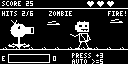
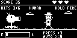

# How to play Garden Guard

Garden Guard runs on STM32. Defend the garden against zombies while
allowing friendly humans to pass. Your laptop shows the original 128 by 64 pixel
game. The board reads the button and sensors, calculates the score, and plays
the buzzer.

Use the physical blue USER/B2 button. The keyboard and mouse do not control the
game. In this guide, "hold fire" means leave the button alone while a human
passes; it does not mean hold the button down.

## Connect and open the game

1. Connect the board's ST-Link USB connector, labelled CN7, to your laptop using
   a USB data cable. Keep the board still in its intended upright position for
   a second or two after power-on or reset so it can establish its orientation.
2. Keep the buzzer on D6/PB1 with its existing power and ground. The damaged OLED
   is optional; use a Grove I2C socket if you connect it. Unplug USB before
   changing wiring.
3. In the Assignment 2 folder, open `tools` and double-click
   `live_display.command`. Alternatively, open a terminal in Assignment 2 and run:

   ```sh
   sh tools/live_display.command
   ```

4. Wait for the LIVE badge and the board's screen. Opening the viewer does not
   reset the board or start a new round.

The viewer targets 30 frames per second. A connected-board check measured about
29.5 displayed frames per second; the status line shows the current measured
rate. This is a live mirror of the board.
`--preview` shows offline artwork.

## Learn the button timing

A double press is two accepted presses **strictly less than 500 ms apart**.
Exactly 500 ms is not a double. Use two distinct quick taps, roughly 100 to
300 ms apart, releasing the button between them. A 30 ms debounce filter rejects
contact bounce; extremely rapid taps may be treated as one press.

A single press is confirmed only after its 500 ms double-press window has
expired. Allow about 0.75 to 1 second between intentional single presses. Tapping
twice too quickly requests a mode change instead of two charges.

| Current state | Single press | Double press | Board LED |
| --- | --- | --- | --- |
| Standby | Ignored | Start a battle round | Continuously on |
| Normal battle | Add energy; automatically fire if charged | Return to standby | One blink per second |
| Attacked battle | Ignored | Rescue before the deadline | Two blinks per second |
| Terminated | Ignored | Ignored | Off |

After an ordinary win or loss, the board remains in battle mode. Its normal
charging and mode controls still work, although the completed round no longer
awards target points.

## Start and read the screen

At standby, double press USER to begin. A fresh round starts with three hearts,
zero points and zero zombie hits. Your goal is to hit six zombies before all
three hearts are lost. Each target has a four-second period unless your shot
ends that encounter sooner.

The screen shows your score, remaining hearts, energy and zombie-hit progress.
Read the target label as well as its shape: `ZOMBIE` means prepare a shot;
`HUMAN` and `HOLD FIRE` mean wait. When a target changes, check its identity
again before pressing. A successful shot can bring the next target immediately.





These images are illustrative frames from the actual firmware renderer,
not evidence of a live play-through.

## Charge, shoot and score

There is no separate shoot button. Each confirmed single press adds three
energy units, up to a capacity of ten. Whenever that addition gives at least
five units, the board immediately fires one shot and spends five units.

Starting from empty, five separate singles produce this sequence:

| Single press | Energy after charging | Automatic shot? | Energy left |
| --- | --- | --- | --- |
| 1 | 3 | No | 3 |
| 2 | 6 | Yes | 1 |
| 3 | 4 | No | 4 |
| 4 | 7 | Yes | 2 |
| 5 | 5 | Yes | 0 |

Watch the energy bar rather than assuming every second press fires. For a first
attempt, make well-separated singles while a zombie is displayed, then stop and
read the new target after each shot. Leave room for the half-second input
decision window instead of tapping at the very end of an encounter.

| Outcome | Score change | Hearts |
| --- | --- | --- |
| Hit a zombie | +10 | Unchanged |
| Hit a zombie while IR aim is locked | +15 total | Unchanged |
| Allow a human to pass for its full four seconds | +5 | Unchanged |
| Shoot a human | -5 | Lose one |
| Let a zombie escape after four seconds | -5 | Lose one |

The reflective IR sensor supplies an optional aim-lock bonus. It detects a
nearby object; it does not identify a human, zombie, red colour or green colour.
The on-screen target decides what your shot hits. You can play without the IR
bonus, and lack of aim lock never blocks automatic firing.

## Warnings, attacks and rescue

A small `!` warning indicates an abnormal or unavailable sensor reading. It
does not by itself mean game over. Sensor monitoring and UART reporting continue;
normal telemetry resumes when all readings return to normal.

An upside-down attack is a separate state. The firmware compares gravity with
the upright reference captured after reset and uses gyro rotation to support
the detection. To try it, start in battle, turn the board smoothly over about
0.5 to 2 seconds, then hold it inverted. Avoid shaking it. A qualifying inverted
position must persist for at least 350 ms.

The attacked screen replaces the target view with a rescue countdown. Double
press USER promptly. Both taps must form a valid double, and its second press
must occur before ten seconds have elapsed since the attack. Exactly 10,000 ms
is too late. A single press has no effect here.

A rescue keeps your score, lives, energy and current target, but restarts that
target's four-second timer. Return upright before attempting another attack.
This rearms detection; staying inverted should not repeatedly trigger new
attacks. Physical flip, rescue and timeout checks remain pending, so rehearse
these actions on the actual board before relying on them in an assessment demo.

## Win, lose and restart

Six zombie hits win the round. Losing all three hearts produces an ordinary
round defeat. To play again after either result, double press to reach standby,
wait briefly, then double press again to start battle. Score, hearts and hit
count reset on battle entry. Energy is preserved across these mode changes.

A missed rescue deadline causes irreversible termination. The board finishes
its final notification, stops UART communication and normal processing, and
waits for a hardware reset. More USER presses cannot rescue it. Press the board's
RESET button to restart in standby with zero energy, then keep it upright while
the new orientation reference is acquired. The laptop retains the final image,
shows `SESSION ENDED`, and stops debugger polling. After resetting the board,
click `Reconnect after reset` to resume the laptop display.

## If something looks wrong

- **No board or disconnected:** check the CN7 data cable and board power. Press
  `Reconnect` in the window, or close and reopen the launcher. A disconnected
  viewer marks the last image as paused.
- **Probe already in use:** close other ST-Link debuggers, programmers and old
  viewer windows, then reconnect. Keep one laptop viewer connected at a time.
- **Firmware mismatch:** the viewer checks the board against the local build.
  Use the matching project firmware and build instructions in the README.
- **Unexpected standby:** two intended charges may have become a double press.
  Space singles farther apart and double press once to re-enter battle.
- **No shot:** the first charge from empty leaves only three energy units.
  Check the bar and make the next single only when shooting is appropriate.
- **Blank or distorted OLED:** use the laptop screen. Damage to that panel does
  not prevent the laptop mirror or D6 buzzer from operating.

Escape or the window close button closes the viewer. The board continues
running, so use standby when you want to stop playing without resetting it.
